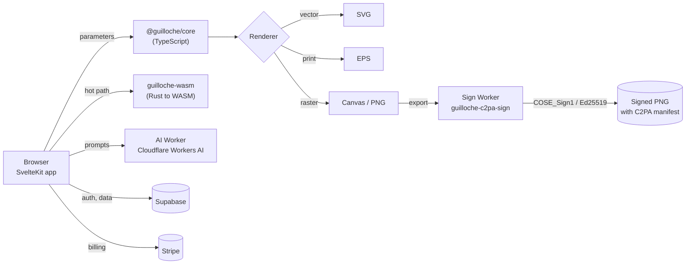

<h3>Guilloché Studio Pro</h3>
<p><strong>Mathematical guilloché pattern generation — engraving-grade ornamental geometry in the browser, exported as signed SVG, EPS, and PNG.</strong></p>

<br clear="left">

<!-- Badge palette: dynamic health; metadata #007ec6; standards #6a4c93; label #20232a; platform brand colors. -->

<p align="center">
  <a href="https://github.com/dcondrey/guillochestudio/actions/workflows/pr.yml"></a>
  <a href="https://github.com/dcondrey/guillochestudio/actions/workflows/codeql.yml"></a>
  <a href="./.bestpractices.json"></a>
  = 22.13">
  = 11">
  
  
  
  
  <a href="https://guillochestudio.com"></a>
  <a href="https://github.com/sponsors/dcondrey"></a>
</p>

<p align="center">
  <a href="#quickstart">Quickstart</a> &middot;
  <a href="#architecture">Architecture</a> &middot;
  <a href="#workspace">Workspace</a> &middot;
  <a href="#the-engine">Engine</a> &middot;
  <a href="#signed-exports">Signed exports</a> &middot;
  <a href="#commands">Commands</a> &middot;
  <a href="#deployment">Deployment</a>
</p>

---

Guilloché is the interlaced, mathematically-generated line ornament used on banknotes,
passports, watch dials, and share certificates. Guilloché Studio Pro generates it from
parametric curve families, edits it live on canvas, and exports print-ready vector art
whose provenance is cryptographically signed at the moment of export.

> [!IMPORTANT]
> **Archived.** Development stopped in October 2026. The repository is read-only and kept for
> reference; the live deployment, if any, is no longer maintained. Issues and pull requests are
> closed.

> [!NOTE]
> This is a product repository, not a library. The packages under `packages/` are
> workspace-internal (`@guilloche/*`) and are not published to npm.

## Quickstart

Prerequisites: Node >= 22.13, pnpm >= 11, and a Rust toolchain with `wasm-pack`
(the pattern engine is compiled to WebAssembly).

```bash
pnpm install
pnpm run build:wasm      # compile the Rust pattern engine to WASM
pnpm dev                 # SvelteKit dev server for apps/web
```

`pnpm dev` runs the web app alone. A full production build chains the WASM engine,
the workspace packages, and the SvelteKit app:

```bash
pnpm build               # build:wasm -> build:packages -> build:web
```

## Architecture



Pattern generation runs in two implementations against the same parameter model: a
TypeScript engine in `@guilloche/core` that is authoritative and easy to debug, and a
Rust/WASM engine for the interactive hot path. Rendering, boolean geometry, and export
stay in TypeScript.

## Workspace

pnpm workspace over `apps/*`, `apps/workers/*`, and `packages/*`.

| Package                  | Kind          | Role                                                                 |
| ------------------------ | ------------- | -------------------------------------------------------------------- |
| `@guilloche/web`         | SvelteKit app | The studio UI, deployed to Cloudflare Pages                          |
| `@guilloche/core`        | TS library    | Engine, `PatternDNA`, renderers, boolean ops, spatial index          |
| `guilloche-wasm`         | Rust → WASM   | High-performance pattern generation for the interactive path         |
| `guilloche-c2pa-sign`    | Rust → WASM   | **Server-only** COSE_Sign1/Ed25519 signing for export manifests      |
| `@guilloche/shared`      | TS library    | Types and helpers shared across apps and workers                     |
| `@guilloche/ai-worker`   | Worker        | Cloudflare Workers AI endpoint for prompt-driven pattern suggestions |
| `@guilloche/sign-worker` | Worker        | Wraps `guilloche-c2pa-sign`; signs PNG exports server-side           |

## The engine

`@guilloche/core` exposes the whole generation and export surface from one entry point.

| Area             | Exports                                                                                     |
| ---------------- | ------------------------------------------------------------------------------------------- |
| Generation       | `GuillocheEngine`, `PatternDNA`, `generator` helpers                                        |
| Renderers        | `SVGRenderer`, `CanvasRenderer`, `EPSRenderer`                                              |
| Boolean geometry | `union`, `intersect`, `difference`, `xor`, `offset`, `simplify`                             |
| Shape primitives | `createCircle`, `createEllipse`, `createRectangle`, `createPolygon`                         |
| Spatial indexing | `PointIndex`, `SegmentIndex`, R-tree bbox queries, point-to-path distance                   |
| Curve fitting    | `fitCurve`, `evaluateBezier`, `bezierToSVGPath`, `flattenBezier`                            |
| Simplification   | `simplifyPath`, `simplifyVisvalingam`, `simplifyRadial`, `simplifyAdaptive`, `resamplePath` |

`PatternDNA` is the serialisable parameter genome for a pattern: it round-trips a design
to a compact form, which is what makes a pattern shareable, versionable, and reproducible
rather than a one-off canvas state.

<details>
<summary><b>Why three renderers rather than one</b></summary>

Guilloché output has three incompatible destinations. `CanvasRenderer` drives the
interactive editor, where per-frame cost dominates. `SVGRenderer` produces the web and
hand-off format, where path structure and layer names matter. `EPSRenderer` targets
engraving and prepress toolchains, which still expect PostScript and will not accept
SVG. Collapsing them into one renderer would mean emitting the weakest common subset of
all three.

</details>

## Signed exports

PNG exports carry a C2PA manifest signed with COSE_Sign1/Ed25519, so an exported
pattern can be traced back to the studio that produced it.

> [!IMPORTANT]
> `guilloche-c2pa-sign` is server-only and must never be bundled into the client. The
> signing key lives in the Worker. `pnpm run build:wasm:sign` builds it and copies the
> artifacts into `apps/workers/sign/src/wasm-sign/`; nothing in `apps/web` imports it.

The C2PA format work this builds on is maintained as standalone crates:
[c2pa-html](https://crates.io/crates/c2pa-html),
[c2pa-structured-text](https://crates.io/crates/c2pa-structured-text), and the rest of
the family, alongside the official [c2pa](https://crates.io/crates/c2pa) SDK.

## Commands

| Command                                        | Does                                                      |
| ---------------------------------------------- | --------------------------------------------------------- |
| `pnpm dev`                                     | SvelteKit dev server for `@guilloche/web`                 |
| `pnpm build`                                   | WASM engine, then workspace packages, then the web app    |
| `pnpm run build:wasm`                          | `wasm-pack build --release` for `guilloche-wasm`          |
| `pnpm run build:wasm:sign`                     | Build the signing WASM and stage it into the sign Worker  |
| `pnpm run build:analyze`                       | Production build with bundle analysis                     |
| `pnpm test`                                    | Vitest across every workspace package                     |
| `pnpm run check` / `typecheck`                 | svelte-check and TypeScript across the workspace          |
| `pnpm lint` / `lint:fix`                       | Lint the workspace                                        |
| `pnpm format` / `format:check`                 | Prettier (with `prettier-plugin-svelte`)                  |
| `pnpm run deploy`                              | Build and publish to Cloudflare Pages (`guillochestudio`) |
| `pnpm run deploy:staging`                      | Same, to the `staging` branch                             |
| `pnpm run db:push` / `db:migrate` / `db:reset` | Supabase schema management                                |

## Deployment

Cloudflare Pages for the app, Cloudflare Workers for AI and signing, Supabase for auth
and data, Stripe for billing. Full walkthrough, including DNS, environment variables,
and Worker secrets: **[DEPLOYMENT.md](./DEPLOYMENT.md)**.

## Working notes

`FEATURE_ROADMAP.md` at the repository root is a working file frozen at the time of
archiving, not documentation. Read `DEPLOYMENT.md` for anything operational.

## License

No license file is present in this repository. Until one is added, treat this as
all-rights-reserved proprietary source.
